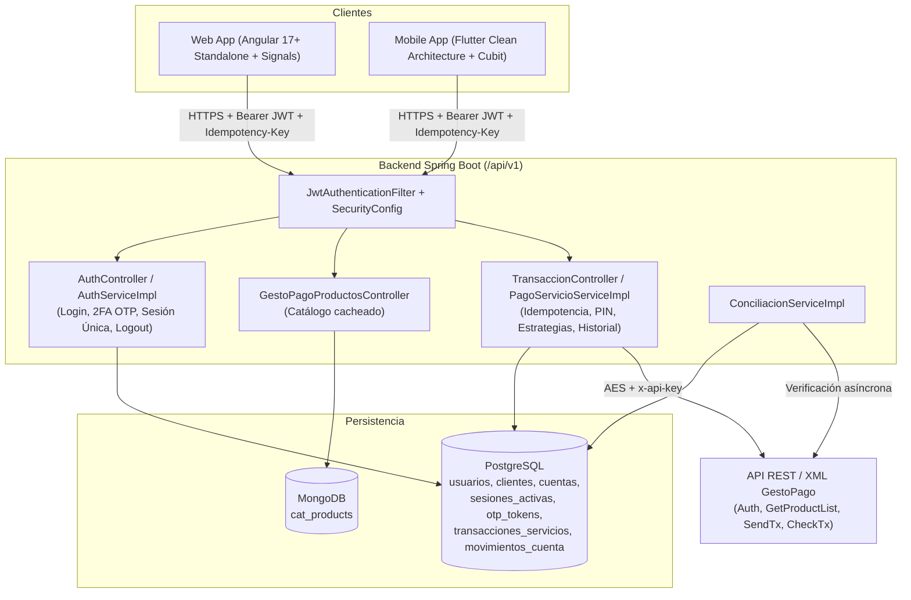

# Documentación Técnica Integral — Ecosistema de Comercio Digital AppHasani (GestoPago)

## 1. Arquitectura General del Ecosistema

El sistema se compone de tres módulos desacoplados que comparten un mismo núcleo de negocio y seguridad bancaria respaldado por el servidor:

1. **Backend Core (`src/`)**: API REST en **Spring Boot 3.3.6 (Java 17)** con arquitectura multicapa (`Controller → Service → Strategy/Gateway → Repository`), migraciones **Flyway**, persistencia transaccional en **PostgreSQL**, caché documental de catálogo en **MongoDB**, e integración segura con la pasarela **GestoPago** (OpenFeign + cifrado AES).
2. **Aplicación Web (`web-app/`)**: SPA responsiva en **Angular 17+ / 18** con Standalone Components, Signals, Reactive Forms, `AuthInterceptor` funcional y `authGuard`.
3. **Aplicación Móvil (`flutter_app/`)**: App multiplataforma en **Flutter / Dart** estructurada con **Clean Architecture** (`core/`, `data/`, `domain/`, `presentation/`) y gestión de estado reactiva mediante **BLoC / Cubit** (`flutter_bloc`), comunicación HTTP con **Dio**, inyección de dependencias con **GetIt**, navegación protegida con **GoRouter** y almacenamiento cifrado con **flutter_secure_storage**.



---

## 2. Decisiones Técnicas y Justificación de Seguridad Informática

### 2.1. ¿Por qué el segundo factor (2FA / OTP) jamás debe validarse únicamente en el frontend?
Validar un código OTP en el cliente (JavaScript en navegador o código Dart compilado) constituye una vulnerabilidad crítica de tipo *Client-Side Security Bypass*:
- Cualquier atacante con herramientas de desarrollo del navegador (`DevTools`), proxy interceptor (`Burp Suite` / `Charles`) o ingeniería inversa del APK puede modificar el booleano de validación o invocar directamente los endpoints protegidos de compra omitiendo la pantalla de 2FA.
- **Implementación en este proyecto (`OtpServiceImpl` + `AuthServiceImpl`)**:
  1. Al superar usuario y contraseña, el endpoint `POST /auth/login` **NO emite el JWT de acceso**; genera un código numérico de 6 dígitos con `java.security.SecureRandom` (`CSPRNG`), almacena únicamente su **hash SHA-256** en PostgreSQL (`otp_tokens`) con vigencia estricta de **5 minutos (300 s)** e invalida códigos previos del usuario.
  2. La verificación ocurre exclusivamente en el servidor mediante `POST /auth/verificar-2fa`, controlando intentos fallidos (**máximo 3 intentos** antes de bloquear el token OTP con HTTP 423), expiración y **protección contra reutilización** (marcado irreversible `usado = true`).
  3. Solo tras superar la validación criptográfica en servidor se genera el JWT definitivo firmado con HMAC-SHA.

### 2.2. Exclusividad de sesión respaldada por el servidor (`sesiones_activas` + `jti`)
Un JWT *stateless* puro no permite invalidar una sesión activa desde otro dispositivo antes de que el token expire. Para garantizar **una sola sesión activa simultánea** entre Web y Móvil sin depender de variables locales del dispositivo:
- Migración `V6__sesiones_activas.sql` crea la tabla `sesiones_activas` en PostgreSQL vinculando `usuario_id`, `jti` (UUID único incluido dentro de los claims del JWT), `dispositivo` (`WEB` o `MOVIL`), `ip_origen`, `activa` y `fecha_expiracion`.
- **Detección de sesión concurrente**: Cuando un usuario autenticado en `MOVIL` intenta iniciar sesión desde `WEB`, `AuthServiceImpl.login()` detecta el registro activo previo en `sesiones_activas` y responde `sesionActivaDetectada = true` con `dispositivoSesionActiva = "MOVIL"`. El usuario debe confirmar el cierre de la sesión anterior (`forzarCierreSesionAnterior = true` o `POST /auth/forzar-cierre-sesion`) antes de avanzar al 2FA.
- **Invalidación inmediata en servidor**: Al emitir el nuevo JWT en `POST /auth/verificar-2fa`, `SesionServiceImpl.registrarNuevaSesion()` marca `activa = false` en todas las sesiones previas del usuario y registra el nuevo `jti`.
- **Validación en cada petición (`JwtAuthenticationFilter`)**: Además de validar la firma y expiración del JWT, el filtro extrae el `jti` y consulta `sesionService.esSesionActiva(jti)`. Cualquier petición posterior desde el dispositivo anterior falla con **HTTP 401/403**, y tanto Angular (`authInterceptor`) como Flutter (`AuthInterceptor`) limpian credenciales locales y redirigen a `/login`.

### 2.3. Seguridad específica por plataforma
- **Flutter (`flutter_app/`)**:
  - Tokens JWT y correo autenticado almacenados cifrados con `flutter_secure_storage` (`EncryptedSharedPreferences` en Android / Keychain en iOS); nunca en `SharedPreferences` en texto plano ni contraseñas persistidas.
  - Enmascaramiento de cabeceras `Authorization` y campos sensibles (`password`, `pin`, `codigo`) en `AuthInterceptor` antes de escribir logs técnicos (`***PROTEGIDO***`).
  - Rutas protegidas centralizadas en `GoRouter.redirect` escuchando reactivamente a `AuthCubit`.
  - Endpoints configurables mediante `--dart-define=API_BASE_URL=...` sin secretos incrustados en código fuente.
- **Web Angular (`web-app/`)**:
  - Token persistido en `sessionStorage` para limitar la exposición entre pestañas/cierres del navegador.
  - Prevención de XSS aprovechando el escape contextual nativo de Angular en plantillas sin uso de `innerHTML` inseguro ni `bypassSecurityTrust*`.
  - Protección de rutas mediante `authGuard` funcional y manejo global de expiración/revocación en `authInterceptor`.
  - Política CORS configurable en `SecurityConfig.java` y autorización por cabecera `Authorization: Bearer` (inmune a ataques CSRF tradicionales basados en cookies automáticas).

### 2.4. Idempotencia, prevención de doble clic y manejo de timeouts en compras
- **Doble clic / concurrencia UI**: Tanto `CompraComponent` (`procesando()`) en Angular como `CompraCubit` (`if (state is CompraLoading) return;`) en Flutter deshabilitan inmediatamente el botón de compra y bloquean despachos simultáneos.
- **Idempotencia en Backend (`PagoServicioServiceImpl`)**: Cada intención de compra genera en el cliente una clave UUID v4 en la cabecera `Idempotency-Key`. El servidor calcula `request_hash` (SHA-256 de los parámetros) y mantiene un índice único `(cuenta_id, idempotency_key)` en PostgreSQL:
  - Misma clave + mismos parámetros + transacción `EXITOSA`/`FALLIDA` → devuelve el resultado previo sin aplicar segundo cargo.
  - Misma clave + parámetros distintos o transacción `PENDIENTE` → responde **HTTP 409 Conflict**.
- **Timeout y respuestas tardías (`202 Accepted`)**: Si GestoPago tarda o devuelve código incierto (`82`), la transacción pasa a `EN_CONCILIACION` (HTTP 202 / `EN_PROCESO`) para verificación en segundo plano (`ConciliacionServiceImpl`). Tanto la app web como la app móvil **impiden reintentar ciegamente** y ofrecen consultar el estado real mediante `GET /api/v1/transacciones/{id}` o revisar el historial antes de generar una nueva clave.

---

## 3. Inventario de Servicios REST Consumidos

Base URL en desarrollo: `http://localhost:8000/api/v1` (en emulador Android: `http://10.0.2.2:8000/api/v1`).  
Todas las respuestas envuelven el resultado en `GenericResponse<T>`:
```json
{
  "codigo": 0,
  "mensaje": "Descripción legible del resultado",
  "datos": {}
}
```

### 3.1. Autenticación, 2FA y Gestión de Sesión Única (`AuthController`)

| Servicio | Método y URL | Autenticación | Entrada JSON / Headers | Respuesta JSON (`datos`) | Códigos HTTP y Manejo de Errores |
|---|---|---|---|---|---|
| **Login (Paso 1)** | `POST /auth/login` | Pública | `{ "correo": "user@banco.com", "password": "...", "dispositivo": "WEB\|MOVIL", "forzarCierreSesionAnterior": false }` | `{ "correo": "...", "requiere2fa": true, "sesionActivaDetectada": false, "dispositivoSesionActiva": null, "tiempoExpiracionOtpSegundos": 300, "mensaje": "..." }` | `200` OK, `400` Validación DTO, `401` Credenciales inválidas, `403` Usuario inactivo, `404` Usuario no encontrado |
| **Verificar 2FA (Paso 2)** | `POST /auth/verificar-2fa` | Pública (requiere OTP vigente) | `{ "correo": "user@banco.com", "codigo": "123456", "dispositivo": "WEB\|MOVIL" }` | `{ "token": "eyJ...", "tipo": "Bearer", "correo": "...", "requiere2fa": false, "mensaje": "Acceso autorizado con éxito." }` | `200` OK, `400` Formato código, `403` Código OTP incorrecto, `422` OTP expirado/inexistente, `423` OTP bloqueado (3 fallos) |
| **Forzar cierre previo** | `POST /auth/forzar-cierre-sesion` | Pública | `{ "correo": "user@banco.com" }` | `true` / `false` | `200` OK |
| **Cerrar sesión segura** | `POST /auth/logout` | Header `Authorization: Bearer <jwt>` | Sin cuerpo | `true` / `false` | `200` OK |

### 3.2. Catálogo de Productos GestoPago (`GestoPagoProductosController`)

| Servicio | Método y URL | Autenticación | Entrada | Respuesta JSON (`datos`) | Códigos HTTP y Errores |
|---|---|---|---|---|---|
| **Obtener catálogo** | `GET /gestopago/productos` | Pública / JWT | Sin parámetros (sincronizado desde MongoDB / GestoPago `getProductList`) | `{ "status": "01", "mensaje": "...", "fechaConsulta": "2026-...", "products": [ { "producto": "Telcel 50", "servicio": "Telcel", "idServicio": 133, "idProducto": 582, "idCatTipoServicio": 1, "tipoFront": 1, "precio": "50.00", "legend": "..." } ] }` | `200` OK, `503` Proveedor o catálogo no disponible |

*Nota de diseño*: Dado que la API de catálogo retorna la lista completa consolidada desde GestoPago (para respetar el límite de consultas diarias del proveedor), tanto Web como Flutter implementan **caché en memoria** y **búsqueda, filtrado por categoría (`tipoFront`: 1 Recargas, 2 Servicios) y paginación** en capa de aplicación.

### 3.3. Clientes y Cuentas Bancarias (`ClienteController`, `CuentaController`)

| Servicio | Método y URL | Autenticación | Entrada JSON | Respuesta JSON (`datos`) | Códigos HTTP |
|---|---|---|---|---|---|
| **Consultar cliente por correo** | `POST /clientes/consultar` | `Bearer <jwt>` | `{ "correo": "user@banco.com", "paginacion": { "pagina": 0, "tamanio": 1 } }` | `PaginaResponse<ClienteResponse>` (`id`, `nombre`, `numeroCuentas[]`) | `200`, `401` |
| **Consultar cuentas del cliente** | `POST /cuentas/consultar` | `Bearer <jwt>` | `{ "clienteId": 1, "paginacion": { "pagina": 0, "tamanio": 10 } }` | `PaginaResponse<CuentaResponse>` (`id`, `numeroCuenta`, `saldo`, `estatus`) | `200`, `401` |

### 3.4. Procesamiento de Compras e Historial (`TransaccionController`)

| Servicio | Método y URL | Autenticación y Headers | Entrada / Parámetros | Respuesta JSON (`datos`) | Códigos HTTP y Manejo de Errores |
|---|---|---|---|---|---|
| **Pagar servicio / recarga** | `POST /transacciones/pago-servicio` | `Authorization: Bearer <jwt>`, `Idempotency-Key: <uuid-v4>` (obligatorio) | `{ "numeroCuenta": "012...", "idProducto": 582, "idServicio": 133, "telefonoReferencia": "5512345678", "monto": 50.00, "pin": "1234" }` | `{ "idTransaccion": 1, "upc": "GP...", "idTxGestoPago": "...", "numeroAutorizacion": "...", "numeroCuenta": "...", "montoDebitado": 50.00, "saldoRestante": 950.00, "telefonoReferencia": "...", "idProducto": 582, "idServicio": 133, "estatus": "EXITOSA\|EN_PROCESO", "mensaje": "...", "fechaTransaccion": "..." }` | `200` Exitosa, `202` En proceso/conciliación, `400` DTO o cabecera faltante, `401` Sesión inválida/revocada, `403` PIN incorrecto, `404` Cuenta/Producto no hallado, `409` Conflicto idempotencia, `422` Saldo insuficiente/monto inválido, `423` PIN bloqueado, `502` Rechazo proveedor (reembolsado), `503` Pasarela no disponible |
| **Consultar estado de transacción** | `GET /transacciones/{id}` | `Authorization: Bearer <jwt>` | Path variable `id` | `PagoServicioResponse` | `200` OK, `401` No autenticado, `404` No encontrada o de otro titular |
| **Consultar historial exitoso** | `GET /transacciones/historial?page=0&size=10` | `Authorization: Bearer <jwt>` | Query `page`, `size`, `sort` (default `fechaTransaccion,DESC`) | `Page<PagoServicioResponse>` (`content[]`, `totalElements`, `totalPages`, `number`, `size`, `last`) filtrado estrictamente por titular autenticado y `estatus = EXITOSA` | `200` OK, `401` Sesión expirada/revocada |

---

## 4. Calidad de Software, Pruebas y DevOps

### 4.1. Ambientes y Variables de Entorno
El backend separa configuración sensible mediante variables de entorno en `application.properties` y archivo `.env` local (excluido en `.gitignore`):
- `SPRING_DATASOURCE_URL`, `SPRING_DATASOURCE_USERNAME`, `SPRING_DATASOURCE_PASSWORD`
- `BANCO_JWT_SECRET` (mínimo 32 caracteres HMAC)
- `GESTOPAGO_AUTH_PASSWORD`, `GESTOPAGO_TX_SECRET_KEY`, `GESTOPAGO_TX_IV`, `GESTOPAGO_TX_API_KEY`
- **Angular Web**: `web-app/src/environments/environment.ts` (desarrollo) y `environment.prod.ts` (producción, reemplazado automáticamente en `ng build --configuration production`).
- **Flutter**: `--dart-define=API_BASE_URL=https://api.tudominio.com/api/v1` al compilar release (`flutter build apk --release --dart-define=...`).

### 4.2. Ejecución de Pruebas Unitarias y Cobertura (JaCoCo + SonarQube)

#### Backend Spring Boot (Java)
```powershell
# Ejecutar suite completa de 171 pruebas unitarias/HTTP y generar reporte JaCoCo
.\gradlew.bat test jacocoTestReport

# Subir análisis estático y cobertura a SonarQube local (asegurar servidor en localhost:9000 encendido)
.\gradlew.bat sonar "-Dsonar.token=squ_5ba7310bddee302e8b08a17d7dd26b0d51eb82bc"
```
Resultados verificados en la última ejecución (`jacocoTestReport.xml`):
- **171 pruebas ejecutadas**, **0 fallidas**, **0 errores**.
- Cobertura en módulo `**/service/**`: **91.07% de líneas** (1051 / 1154) y **63.93% de ramas** (257 / 402) — **~84.06% combinado SonarQube**, superando la meta mínima del 80%.

#### Aplicación Web (Angular)
```bash
cd web-app
npm install
npm start       # Levanta servidor de desarrollo en http://localhost:4200
npm run build   # Compila bundle optimizado de producción
```

#### Aplicación Móvil (Flutter)
```bash
cd flutter_app
flutter pub get
flutter test    # Ejecuta AuthCubit y CompraCubit unit tests
flutter run --dart-define=API_BASE_URL=http://10.0.2.2:8000/api/v1
```

---

## 5. Guía de Demostración — Escenario Práctico de Evaluación

1. **Acceso móvil + 2FA**: Abrir `flutter_app`, iniciar sesión con usuario/contraseña válidos. Observar solicitud de código OTP de 6 dígitos en servidor (enviado por correo o visible en log de consola Spring Boot para validación en desarrollo). Completar verificación 2FA y acceder al catálogo.
2. **Catálogo y compra real**: Filtrar o buscar un producto en Flutter, consultar detalle, ingresar cuenta/referencia/monto/PIN y confirmar pago. Validar comprobante real emitido por GestoPago y verificar aparición cronológica en **Historial**.
3. **Exclusividad de sesión (Móvil → Web)**: Manteniendo la sesión activa en Flutter, abrir `web-app` (`http://localhost:4200`) e intentar iniciar sesión con el mismo usuario. Confirmar detección de sesión previa en `MOVIL`, aceptar finalizar la sesión anterior y completar el nuevo 2FA en Web.
4. **Revocación real en servidor**: Volver a Flutter e intentar recargar el historial o el perfil; comprobar que el backend rechaza el token anterior (`jti` invalidado en `sesiones_activas`) y Flutter redirige automáticamente a Login.
5. **Protección contra doble clic y timeout**: En el formulario de compra, pulsar rápidamente dos veces; verificar que el botón queda bloqueado y se conserva la misma `Idempotency-Key`. Ante estado incierto/timeout, usar el botón de verificación de estado real (`GET /transacciones/{id}`) antes de reintentar.
6. **Seguridad y consistencia entre plataformas**: Intentar navegar directamente a `/catalogo` o `/historial` sin token (redirige a `/login`), revisar logs confirmando que contraseñas, tokens y PIN están enmascarados, y contrastar que catálogo e historial muestran exactamente los mismos datos comerciales en Web y Flutter.

